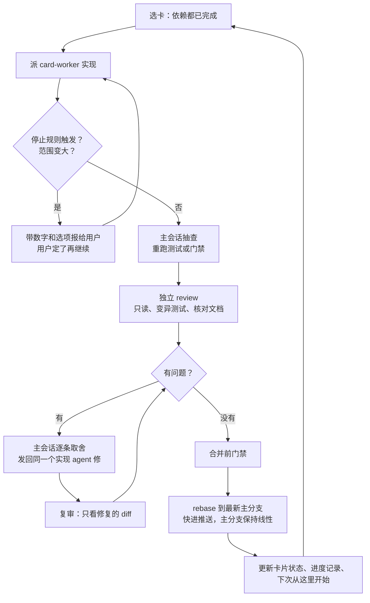

# card-driven-dev

一个 [Claude Code](https://docs.claude.com/en/docs/claude-code) skill，把一个项目拆成任务卡，一张一张地推进完。

分工：
- **你**：定需求、做取舍、给授权；
- **主会话**（你正在聊天的那个 Claude）：拆卡、派活、把关、合并；
- **sub agent**：实现每张卡，再由另一个 agent 独立 review。

每一步都留下能核对的证据：测试名、样本、命令输出、提交号。「完成」要靠证据说明，不靠 agent 自己的报告。

skill 正文是中文。

## 目录

- [安装](#安装)
- [一、从零开始：讨论需求、拆卡、启动](#一从零开始讨论需求拆卡启动)
- [二、用 /goal 持续推进](#二用-goal-持续推进)
- [三、边聊边补卡](#三边聊边补卡)
- [四、换主会话](#四换主会话)
- [五、Agent 的完整流程](#五agent-的完整流程)
- [看板](#看板)
- [仓库内容](#仓库内容)

## 安装

```sh
git clone https://github.com/oxsean/card-driven-dev.git ~/src/card-driven-dev
ln -s ~/src/card-driven-dev ~/.claude/skills/card-driven-dev
mkdir -p ~/.claude/agents
ln -s ~/src/card-driven-dev/agents/card-worker.md ~/.claude/agents/card-worker.md
```

- `card-worker` 是 skill 用来实现卡的长任务 agent（Opus，最多 1000 轮）。
- 没装它也能用：skill 会改派 `general-purpose`。但它 200 轮就停，做到一半要你让主会话叫它接着做。

skill 会在下面这些说法上自动触发：「开个新项目」「拆卡」「按任务卡推进」「照上次的流程来」「开看板」。也可以直接输入 `/card-driven-dev`。

## 一、从零开始：讨论需求、拆卡、启动

### 1. 讨论需求

在项目目录里打开 Claude Code，直接说你要做什么，例如：

> 我想做一个 xxx，用 card-driven-dev 的流程来，先跟我讨论需求。

主会话会先问清下面这些，不会一上来就写代码：

| 问什么 | 例子 |
|---|---|
| 目标和边界 | 做什么、不做什么、给谁用、做到什么程度算完 |
| 环境 | 能不能联网；内存和磁盘上限；机器同时能跑几个 agent；在哪台机器上编译和测试 |
| 数据 | 测试数据用什么（虚构域名、虚构 ID）；密钥怎么存、怎么传 |
| 授权 | 哪些事可以直接做；哪些要先给计划、等你批准（改机器配置、建测试环境、对外发布） |
| 交付 | 文档放哪里、提交到哪里、用什么语言 |
| 标准答案 | 有没有能给出「真实行为」的参照：官方实现、真实服务、抓包、线上样本 |

约束会写进项目的 `CLAUDE.md`，以后每张卡都遵守。你的每个取舍都带上日期和「谁定的」，定下来的事以后不再反复讨论。

有标准答案时，第一批卡就做对照工具：先拿到真实的输出（golden 样本），再写代码，测试按字节比对。

### 2. 写设计文档、拆卡

需求定下来后，主会话会：

1. 写设计文档，放在仓库里（如 `docs/design.md` 或 `docs/design/`），按章节编号。卡片用「§x」引用章节。
2. 按里程碑拆卡，放进 `docs/tasks/`：
   - 主线用 `M0.md` … `Mn.md`，增强包用 `E1.md` … `En.md`；
   - 每个里程碑最后一张是 **GATE 卡**，做端到端验收。
3. 写 `docs/tasks/README.md`：下次从这里开始、文件与进度表、待办（backlog）、进度记录、工作流程。

一张卡长这样：

```markdown
## M1-core-01 连接管理
- **依赖**：M0-repo-01
- **范围**：做什么；不做什么（写明推迟到哪张卡）。
- **产出**：代码路径、命令、文档。
- **验证**：不依赖没做完的卡；每条都有明确的通过标准（测试名 / 对照工具 / 真实环境现象 / 命令输出）。
- **规模**：中 · **参考**：§3.2
```

状态行在做了之后才加。完整模板在 [references/templates.md](references/templates.md)。

拆完先自己读一遍卡，不满意就直接说，例如「M1 太大，拆成两个里程碑」「这张卡的验证不够，要加对照测试」。

### 3. 启动

卡片确认后说：

> 按任务卡推进。

主会话会从 README 的「下次从这里开始」挑第一张依赖已齐的卡，派 agent 去做，然后按第五节的流程一张接一张往下走。

这些事主会话会停下来问你：
- GATE 卡的端到端验收开跑之前；
- 推送、发布、对外操作；
- 你在 `CLAUDE.md` 里写了「要先问」的事。

## 二、用 /goal 持续推进

想让主会话一直推进、不用每张卡都催一句，就设一个长期目标：

```
/goal 继续按照任务卡推进
```

设了目标之后：

- 主会话做完一张卡，会自己接着挑下一张，不停下来等你说「继续」。
- 后台 agent 在跑时，目标检查会顺延，等它跑完再看。agent 不报结果就停了，主会话会去查它的状态，必要时重派。
- 遇到真正要你定的事（产品取舍、超出范围的新机制、对外操作），主会话停下来问你，不自己拍板。
- 你可以随时插话，比如问「现在在做什么」「还要多久」，或者改优先级。
- 目标达成或你想停时，清掉目标即可。

你要离开一段时间，可以先交代一句：

> 待定的都按推荐选项定。

这样主会话遇到普通的取舍会按推荐选项暂定，标上「暂定待复核」，写进 README 的「待用户复核」，不会卡住。你回来后一次过一遍，同意就删行，不同意就改。「要先问」的事仍然会停下来等你。

另一种推进方式是 `/loop`：

```
/loop 根据任务卡状态，按照任务推进
```

`/loop` 靠 agent 的完成通知往下走，每轮结束设一个长间隔的兜底唤醒。不建议给固定间隔（如 `/loop 15m …`）：完成通知已经能推进，固定间隔每次都要重发整段上下文，费用更高。

## 三、边聊边补卡

推进过程中，随时可以直接跟主会话说新想法：

> 我觉得还应该支持 xxx。
> 这张卡做完以后，加一个压测。
> M2 之前先把 xxx 的设计补上。

主会话的处理方式：

1. **先讨论**：问清楚范围和要定的事，不会直接开工。
2. **能排期的拆成卡**：写进对应里程碑的文件，标好依赖，必要时调整顺序。
3. **排不上的进 backlog**：写在 `docs/tasks/README.md` 的「待办」，带记录日期、由来（谁提的、哪张卡发现的）、范围、要决定的事和规模。
4. **改了已定的设计**：同时改设计文档和受影响的卡，在决定记录里写明日期和谁定的。

实现中发现的问题也一样处理，例如 review 发现的范围外缺陷、测量发现的性能差距：先报给你，你定了才变成卡或 backlog，agent 不会自己扩大范围。

待定的事一多，可以让主会话做一张本地 HTML 表单：每项写清「这是什么、为什么要定」，推荐选项预先勾好，你一次勾完，把结果贴回聊天。

## 四、换主会话

主会话处理了很多卡、很多条 agent 通知以后，上下文会变重，变慢、变贵。到了自然的断点就换一个新的主会话：
- 一张大卡合并后；
- 一个里程碑或一条工作线做完后；
- 主会话已经处理过很多条通知时。

步骤：

1. **等后台 agent 都跑完。** 后台 agent 属于当前会话，会话一关它们就停了，停掉的 agent 不能再续。
2. **让主会话写交接：**

   > 准备换会话，把交接写好。

   交接写进 `docs/tasks/README.md` 的「下次从这里开始」，包括：
   - 当前卡和它的分支、worktree；
   - 已定和暂定的决定；
   - 等你回答的问题；
   - 下一步的第一件事。

   需要的话，也可以另写一份交接说明文件。
3. **开新会话**，第一句说：

   > 读 CLAUDE.md 和 docs/tasks/README.md 的「下次从这里开始」，继续按任务卡推进。

   想让它一直推进，再设一次 `/goal`。

如果会话意外中断、agent 停在一半：新会话会在同一个 worktree 里新派一个 card-worker，prompt 写明已经完成的部分，接着做。

## 五、Agent 的完整流程

### 角色

| 角色 | 谁 | 做什么 |
|---|---|---|
| 用户 | 你 | 需求、取舍、授权；复核暂定的决定 |
| 主会话 | 你聊天的那个 Claude | 选卡、写 prompt、抽查、取舍 review 意见、合并、更新进度 |
| 实现 agent | `card-worker` | 按卡实现、跑测试、写卡片记录；按 review 返工 |
| review agent | 另一个只读 agent | 独立找问题、做变异测试、核对文档；复审只看修复的 diff |

### 每张卡的流程



逐步说明：

1. **选卡**：看卡片的状态行和 README「下次从这里开始」，挑依赖都已完成的卡。
2. **实现**：派一个 `card-worker`。它不继承主会话的对话，所以 prompt 要能独立读懂，写清这些：
   - 卡号、背景、已定的决定（写明不再讨论）；
   - 先读哪些文件和章节；
   - 代码地图：要改的文件、入口、可以照着写的已有实现；
   - 测试命令；
   - 要更新哪些文档。

   大卡按自然边界分几轮做：一种语言、一个子系统或一个阶段做完一轮。每轮新派一个 agent，靠一份不超过两页的交接说明传下去。超过 10 分钟的命令（全量测试、基准）放到会话外运行，agent 等进程退出，不轮询。
3. **验证**：实现 agent 回来后，主会话自己再跑一遍测试或门禁，不只信报告。
4. **独立 review**：另开一个只读 agent。它要做这些：
   - 按 high / medium / low 列问题，每条带 `file:line`、失败场景和修法；
   - 在临时副本里做变异测试，证明测试真的能失败；
   - 核对文档前后一致，有没有把推断写成实测。
5. **修复**：主会话先取舍，再把问题清单发回同一个实现 agent（它保留着全部上下文）。修完由同一个 reviewer 复审，只读修复的 diff。
6. **收尾**：
   - 门禁通过后，逐个文件暂存提交（不用 `git add -A`）；
   - 工作分支 rebase 到最新主分支，快进推送；
   - 已经推过的分支不强推；
   - 卡片状态行、进度记录、「下次从这里开始」同时更新。
7. 下一张。

### 停下来问你的时机

agent 和主会话在这些情况下停，带着数字和选项来问你：

- 设计没写到的细节会改对外的东西：线上格式、公开 API、跨语言行为。
- 方案变大：要加新机制、新选项、新模式，或为边缘情况加额外处理。这时会同时报最简单的做法（包括「只在文档里写明限制」）和较大的做法，各带代价。
- 卡片写了停止规则（例如性能预测偏差超过 30%、行数超预算 30%），实测触发了。
- GATE 卡开跑、推送发布、对外操作。

### 质量要求

- 修 bug 先写修改前会失败的测试。
- review 用变异测试证明测试有效。
- 「完成」要有能观察到的证据；没测过的结论标「推断」。
- 每份 agent 报告都有「偏离惯例」「使用者想不到的行为」「砍掉和推后的」三节。

细则见 [references/testing-review.md](references/testing-review.md)。

### 并行

默认串行，因为独占资源、公共文件和卡之间的依赖都会冲突。能并行的：

- 只靠单元测试的功能、调研、backlog 小修，用 worktree 隔离开 agent，做完按顺序 rebase、快进合并；
- 卡 N 在 review 时，卡 N+1 只靠单元测试的部分可以先开工。

并行上限开工时问你，没说就是 2 个，reviewer 也算在内。

### 控制用量

花费约等于「调用次数 × 每次带的上下文」：

- effort 按难度给：机械活（合并、更新记录）`low`，照已定方案实现或返工 `medium`，设计、评审、疑难排查 `high`。
- 每轮新派 agent，不让一个 agent 带着越来越长的历史一直干。
- agent 给主会话的报告不超过 10 行，细节写进卡片或 review 文件。
- 会挡住工作的问题先和你定下来再派，不带着没定的问题开工。

## 看板

在聊天里说「开看板」，主会话会在本机起一个只读网页，每 3 秒读一次任务卡和 git 历史。也可以手动启动：

```sh
python3 ~/.claude/skills/card-driven-dev/board/board.py --repo <你的仓库>   # http://127.0.0.1:8765/
python3 ~/.claude/skills/card-driven-dev/board/board.py --repo <你的仓库> --dump   # 输出一次数据
```

两个视图，右上角切换：

- **星图**：每个里程碑一列，卡是星，依赖是曲线；进行中的卡有光环，卡完成时迸出粒子。
- **信息**：卡片格、进度环、预计完成曲线、最近提交。

它从 `~/.claude/projects/` 下的会话记录算 agent 的执行时间，再按已完成卡的节奏估算剩余时间。只读，不写仓库，只依赖 Python 3 标准库。说「关看板」就停掉。

看板靠卡片的写法识别状态：
- 标题 `## <卡号> <标题>`；字段 `- **状态**`、`- **依赖**`、`- **规模**`；
- 状态以「完成」「部分完成」「关闭」开头算完成，「未开始」算没开始，其他非空状态算进行中；
- 提交说明带 `(<卡号>)`，看板据此取完成时间。

## 仓库内容

| 路径 | 内容 |
|---|---|
| `SKILL.md` | skill 正文：四个阶段、每张卡的流程、质量、自动推进、看板、并行、控制用量、安全、常见坑 |
| `references/templates.md` | 任务卡、README、实现 prompt、review prompt 的模板 |
| `references/testing-review.md` | 测试设计、回归、review 与修复的细则 |
| `references/reference-and-lab.md` | 有标准答案时怎么做对照工具；需要真实环境时怎么做实验 |
| `agents/card-worker.md` | 实现 agent 的定义 |
| `board/` | 进度看板（`board.py` 服务端，`board.html` 页面） |

## License

MIT
